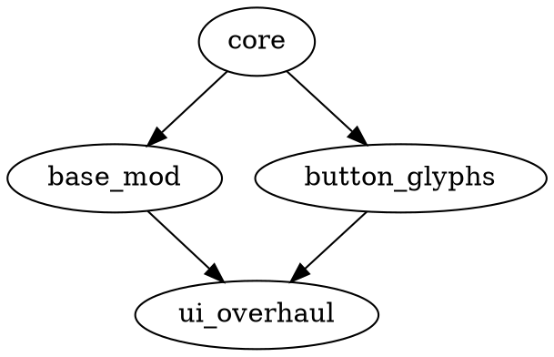

# Looking Glass Launcher CLI Reference

Complete command reference for `looking-glass-launcher` mod management commands.

---

## Overview

```bash
looking-glass-launcher [OPTIONS] [COMMAND]
```

The launcher provides mod management through subcommands. All mod commands operate on the current game target (default: `Alice`).

---

## Global Options

| Option | Description |
|--------|-------------|
| `--game <TARGET>` | Target game: `Alice` or `AliceDemo` (default: `Alice`) |
| `--mods-dir <PATH>` | Override mods directory |
| `--config <PATH>` | Override config file |
| `-v, --verbose` | Verbose output |
| `-q, --quiet` | Suppress non-error output |
| `--help` | Show help |
| `--version` | Show version |

---

## Mod Commands

### `mod list` - List Installed Mods

```bash
looking-glass-launcher mod list [OPTIONS]
```

**Options**:
- `--enabled` - Show only enabled mods
- `--disabled` - Show only disabled mods
- `--format <FORMAT>` - Output format: `table` (default), `json`, `csv`

**Output (table)**:
```
ID              NAME              VERSION  ENABLED  GAME TARGET
button_glyphs   Button Glyphs     1.2.0    yes      Alice
hd_textures     HD Textures       2.0.1    no       Alice
```

**Output (json)**:
```json
[
  {
    "id": "button_glyphs",
    "name": "Button Glyphs",
    "version": "1.2.0",
    "enabled": true,
    "game_target": "Alice",
    "installed_at": "2024-01-15T10:30:00Z",
    "checksum": "abc123...",
    "path": "/home/user/.local/share/looking-glass/mods/Alice/button_glyphs"
  }
]
```

---

### `mod info` - Show Mod Details

```bash
looking-glass-launcher mod info <MOD_ID> [OPTIONS]
```

**Options**:
- `--format <FORMAT>` - Output format: `text` (default), `json`

**Output (text)**:
```
ID:              button_glyphs
Name:            Button Glyphs
Version:         1.2.0
Author:          Looking Glass Team
Description:     Replaces keyboard button prompts with controller glyphs
Game Target:     Alice
Min Game Version: 0.30.0
Enabled:         yes
Installed:       2024-01-15T10:30:00Z
Checksum:        abc123def456...
Path:            /home/user/.local/share/looking-glass/mods/Alice/button_glyphs

Dependencies:
  core >=1.0.0 (required) - SATISFIED (1.5.0)

Entry Points:
  asset_override: scripts/assets.rs
  config_inject:  scripts/config.rs
  input_hook:     scripts/input.rs
  runtime_hook:   scripts/runtime.rs
  ui_patch:       scripts/ui_patch.rs

Config Schema:
  glyph_style: enum [playstation, xbox, switch, generic] (default: playstation)
  show_keyboard_fallback: boolean (default: true)
  scale: number [0.5, 2.0] (default: 1.0)

Current Config:
  glyph_style: xbox
  show_keyboard_fallback: false
  scale: 1.2

Assets: 16 overrides declared
Tags: ui, accessibility, controller, glyphs
```

---

### `mod install` - Install Mod from Archive

```bash
looking-glass-launcher mod install <ARCHIVE_PATH> [OPTIONS]
```

**Supported Formats**: `.zip`, `.tar.gz`, `.tgz`, `.tar`

**Options**:
- `--force` - Overwrite existing mod (same ID/version)
- `--no-verify` - Skip checksum verification
- `--enable` - Enable mod after install (default: true)

**Examples**:
```bash
# Install from zip
looking-glass-launcher mod install button_glyphs_v1.2.0.zip

# Install and disable
looking-glash-launcher mod install my_mod.zip --enable=false

# Force reinstall
looking-glass-launcher mod install button_glyphs_v1.2.0.zip --force
```

**Output**:
```
Installing mod from button_glyphs_v1.2.0.zip...
Validating manifest...
Checking dependencies...
Extracting to /home/user/.local/share/looking-glass/mods/Alice/button_glyphs...
Computing checksum: abc123def456...
Mod installed successfully: button_glyphs v1.2.0
Mod enabled.
```

---

### `mod uninstall` - Uninstall Mod

```bash
looking-glass-launcher mod uninstall <MOD_ID> [OPTIONS]
```

**Options**:
- `--keep-config` - Keep mod config file
- `-y, --yes` - Skip confirmation

**Examples**:
```bash
looking-glass-launcher mod uninstall button_glyphs
looking-glash-launcher mod uninstall hd_textures --keep-config -y
```

**Output**:
```
Uninstalling mod: button_glyphs
Removing directory: /home/user/.local/share/looking-glass/mods/Alice/button_glyphs
Mod uninstalled successfully.
```

---

### `mod enable` - Enable Mod

```bash
looking-glass-launcher mod enable <MOD_ID>
```

**Output**:
```
Enabling mod: button_glyphs
Mod enabled successfully.
```

---

### `mod disable` - Disable Mod

```bash
looking-glash-launcher mod disable <MOD_ID>
```

**Output**:
```
Disabling mod: button_glyphs
Mod disabled successfully.
```

---

### `mod validate` - Validate Mod Manifest

```bash
looking-glass-launcher mod validate <MOD_DIR> [OPTIONS]
```

**Options**:
- `--schema <PATH>` - Custom schema file (default: built-in)
- `--strict` - Treat warnings as errors

**Examples**:
```bash
# Validate mod directory
looking-glass-launcher mod validate ~/.local/share/looking-glass/mods/Alice/my_mod

# Validate with strict mode
looking-glass-launcher mod validate ./my_mod --strict
```

**Output (success)**:
```
Validating mod at /home/user/.local/share/looking-glass/mods/Alice/my_mod...
Manifest: valid
Schema: valid
Dependencies: satisfiable (core >=1.0.0 found)
Assets: 3 declared, 3 found
Checksum: abc123def456 (matches)
Result: VALID
```

**Output (failure)**:
```
Validating mod at /home/user/.local/share/looking-glass/mods/Alice/bad_mod...
Manifest: INVALID
Errors:
  - Missing required field: version
  - Invalid game_target: "UnknownGame" (expected: Alice, AliceDemo)
  - Dependency "missing_mod" not found
Result: INVALID
```

---

### `mod load-order` - Show/Manage Load Order

```bash
looking-glass-launcher mod load-order [OPTIONS]
```

**Options**:
- `--format <FORMAT>` - Output format: `table` (default), `json`, `dot`
- `--check` - Check for circular dependencies only

**Output (table)**:
```
LOAD ORDER (topological):
1. core (no deps)
2. base_mod (after: core)
3. button_glyphs (after: core, before: ui_overhaul)
4. ui_overhaul (after: base_mod)
5. hd_textures (no constraints)
```

**Output (dot)**:


---

### `mod config` - Manage Mod Configuration

```bash
looking-glass-launcher mod config <MOD_ID> [SUBCOMMAND]
```

#### `mod config show` - Show Current Config

```bash
looking-glash-launcher mod config <MOD_ID> show [OPTIONS]
```

**Options**:
- `--format <FORMAT>` - Output format: `toml` (default), `json`

**Output**:
```toml
glyph_style = "xbox"
show_keyboard_fallback = false
scale = 1.2
```

#### `mod config set` - Set Config Value

```bash
looking-glass-launcher mod config <MOD_ID> set <KEY> <VALUE>
```

**Examples**:
```bash
looking-glass-launcher mod config button_glyphs set glyph_style xbox
looking-glass-launcher mod config button_glyphs set scale 1.5
looking-glass-launcher mod config button_glyphs set show_keyboard_fallback false
```

#### `mod config get` - Get Config Value

```bash
looking-glash-launcher mod config <MOD_ID> get <KEY>
```

**Output**:
```
xbox
```

#### `mod config reset` - Reset to Defaults

```bash
looking-glash-launcher mod config <MOD_ID> reset [OPTIONS]
```

**Options**:
- `--key <KEY>` - Reset specific key (default: all)

---

### `mod create` - Create New Mod Template

```bash
looking-glass-launcher mod create <MOD_ID> [OPTIONS]
```

**Options**:
- `--name <NAME>` - Mod display name (default: MOD_ID)
- `--author <AUTHOR>` - Author name
- `--description <DESC>` - Mod description
- `--template <TEMPLATE>` - Template: `empty`, `asset-override`, `config-injection`, `input-hook`, `ui-patch`, `button-glyphs` (default: `empty`)
- `--dir <PATH>` - Output directory (default: current directory)

**Examples**:
```bash
# Empty template
looking-glass-launcher mod create my_mod --name "My Mod" --author "Me"

# Asset override template
looking-glass-launcher mod create hd_walls --template asset-override

# Button glyphs template (complete example)
looking-glash-launcher mod create my_glyphs --template button-glyphs
```

**Output**:
```
Creating mod template: my_mod
Writing: my_mod/mod.toml
Writing: my_mod/README.md
Writing: my_mod/assets/.gitkeep
Writing: my_mod/scripts/.gitkeep
Mod template created at ./my_mod
Edit mod.toml and add your assets/scripts.
```

---

## Game Commands

### `run` - Launch Game with Mods

```bash
looking-glass-launcher run [OPTIONS]
```

**Options**:
- `--mod <MOD_ID>` - Enable specific mod (can repeat)
- `--no-mods` - Disable all mods
- `--profile <NAME>` - Use mod profile
- `--validate` - Validate all mods before launch
- `--args <ARGS>` - Additional game arguments

**Examples**:
```bash
# Launch with all enabled mods
looking-glash-launcher run

# Launch with specific mods only
looking-glash-launcher run --mod button_glyphs --mod hd_textures

# Launch without mods
looking-glash-launcher run --no-mods

# Validate then launch
looking-glash-launcher run --validate
```

---

### `validate` - Validate Game Data

```bash
looking-glash-launcher validate [OPTIONS]
```

**Options**:
- `--all` - Validate all game data
- `--mods` - Validate installed mods only
- `--config` - Validate config only

---

## Config Commands

### `config show` - Show Effective Config

```bash
looking-glash-launcher config show [OPTIONS]
```

**Options**:
- `--format <FORMAT>` - Output format: `toml` (default), `json`
- `--source` - Show config source for each value

**Output**:
```toml
# Global config (~/.config/looking-glass/config.toml)
[game]
data_path = "/home/user/Games/Alice"
auto_setup = true

[launcher]
log_level = "info"
theme = "dark"

[mods.button_glyphs]
glyph_style = "xbox"
scale = 1.2
```

---

### `config set` - Set Config Value

```bash
looking-glash-launcher config set <KEY> <VALUE> [OPTIONS]
```

**Options**:
- `--global` - Set in global config (default)
- `--project` - Set in project config (private/config.toml)
- `--mod <MOD_ID>` - Set in mod config namespace

**Examples**:
```bash
looking-glash-launcher config set game.data_path "/Games/Alice"
looking-glash-launcher config set launcher.theme dark
looking-glash-launcher config set mods.button_glyphs.glyph_style xbox --mod button_glyphs
```

---

### `config edit` - Open Config in Editor

```bash
looking-glash-launcher config edit [OPTIONS]
```

**Options**:
- `--global` - Edit global config
- `--project` - Edit project config

---

## Profile Commands

### `profile list` - List Mod Profiles

```bash
looking-glash-launcher profile list
```

### `profile save` - Save Current Mod Set as Profile

```bash
looking-glash-launcher profile save <NAME>
```

### `profile load` - Load Profile

```bash
looking-glash-launcher profile load <NAME>
```

### `profile delete` - Delete Profile

```bash
looking-glash-launcher profile delete <NAME>
```

---

## Utility Commands

### `doctor` - Diagnose Issues

```bash
looking-glash-launcher doctor [OPTIONS]
```

**Options**:
- `--fix` - Attempt to fix common issues

**Checks**:
- Game data integrity
- Mod manifest validity
- Dependency satisfaction
- Config file syntax
- Directory permissions
- Disk space

---

### `cache clear` - Clear Caches

```bash
looking-glash-launcher cache clear [OPTIONS]
```

**Options**:
- `--mods` - Clear mod cache
- `--assets` - Clear asset cache
- `--all` - Clear all caches (default)

---

## Exit Codes

| Code | Meaning |
|------|---------|
| 0 | Success |
| 1 | General error |
| 2 | Invalid arguments |
| 3 | Mod not found |
| 4 | Validation failed |
| 5 | Dependency error |
| 6 | IO error |
| 7 | Config error |

---

## Environment Variables

| Variable | Description |
|----------|-------------|
| `LOOKING_GLASS_MODS_DIR` | Override mods directory |
| `LOOKING_GLASS_CONFIG` | Override config file |
| `LOOKING_GLASS_GAME` | Default game target |
| `RUST_LOG` | Logging level (e.g., `debug`, `info`, `warn`) |

---

## Configuration Files

### Global Config: `~/.config/looking-glass/config.toml`

```toml
version = 2

[game]
data_path = "/path/to/Alice"
auto_setup = true
preferred_language = "en"

[launcher]
log_level = "info"
auto_check_updates = true
theme = "dark"
first_run = false

[platform]
steam_path = "/path/to/steam"
heroic_path = "/path/to/heroic"
flatpak_enabled = false
wine_prefix = "/path/to/wine"
proton_version = "GE-Proton-8"

[mods]
mod_dirs = ["/custom/mods"]
auto_enable_new = true
check_updates = true
default_profile = "default"

[saves]
backup_dir = "/backups"
auto_backup = true
max_backups = 10
sync_enabled = false
sync_provider = "local"
```

### Project Config: `<project_root>/private/config.toml`

Same structure as global config, overrides global settings.

### Mod Config: `mods/<game>/<mod_id>/config.json`

```json
{
  "glyph_style": "xbox",
  "show_keyboard_fallback": false,
  "scale": 1.2
}
```

---

## Examples

### Install and Enable Mod

```bash
# Download mod
wget https://github.com/user/mod/releases/download/v1.0.0/mod.zip

# Install
looking-glass-launcher mod install mod.zip

# Verify
looking-glash-launcher mod info mod_id

# Launch game
looking-glash-launcher run
```

### Create Mod Profile

```bash
# Enable desired mods
looking-glash-launcher mod enable button_glyphs
looking-glash-launcher mod enable hd_textures
looking-glash-launcher mod disable gameplay_tweaks

# Save as profile
looking-glash-launcher profile save "visual_enhancements"

# Later: load profile
looking-glash-launcher profile load "visual_enhancements"
looking-glash-launcher run
```

### Debug Mod Issues

```bash
# Check mod status
looking-glash-launcher mod list

# Validate specific mod
looking-glash-launcher mod validate /path/to/mod

# Check load order
looking-glash-launcher mod load-order --check

# Run doctor
looking-glash-launcher doctor --fix
```

---

## See Also

- [MODDING_GUIDE.md](MODDING_GUIDE.md) - Complete modding guide
- [MANIFEST_SCHEMA.md](MANIFEST_SCHEMA.md) - Manifest schema reference
- [API_REFERENCE.md](API_REFERENCE.md) - Rust API documentation
- [EXAMPLE_MODS/](EXAMPLE_MODS/) - Working examples